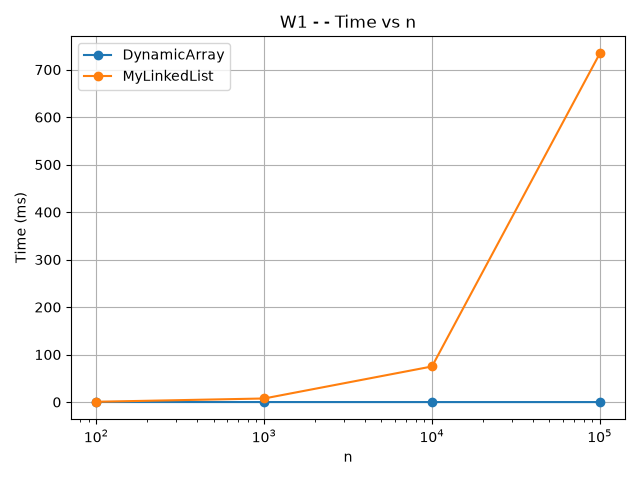
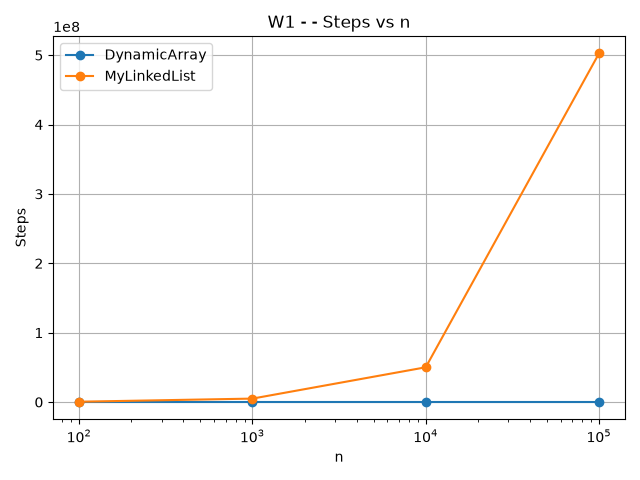
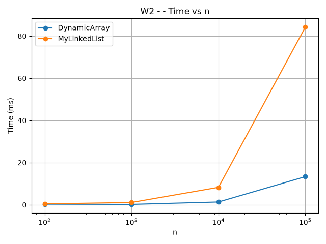
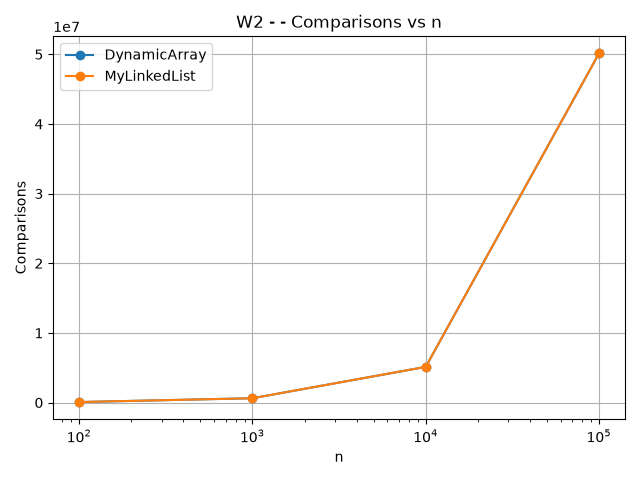
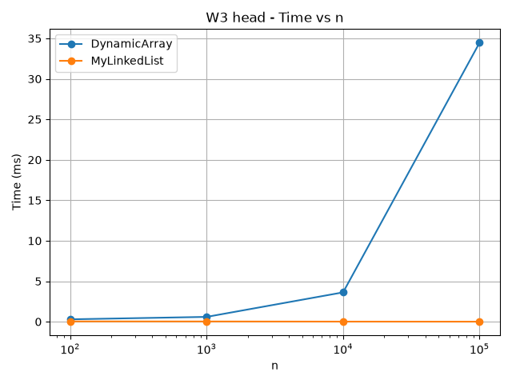
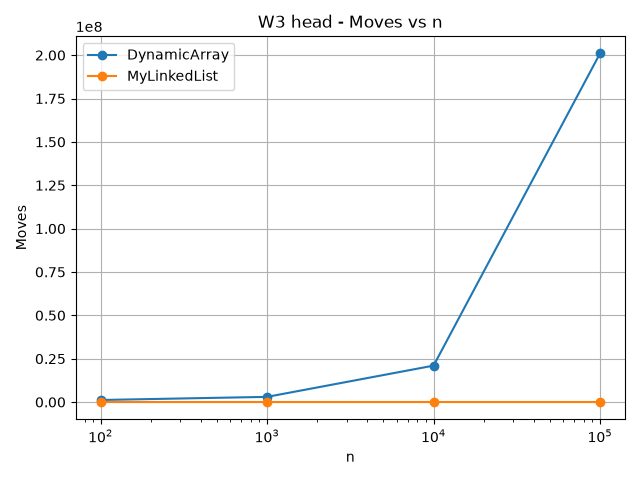
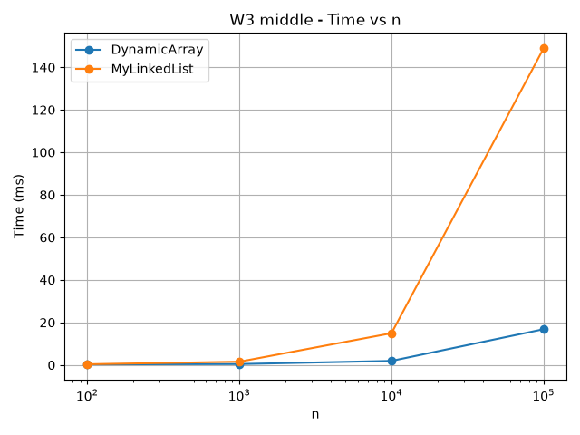
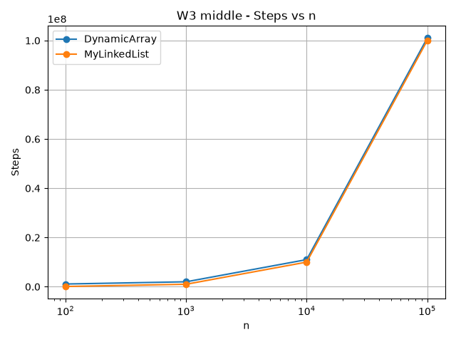
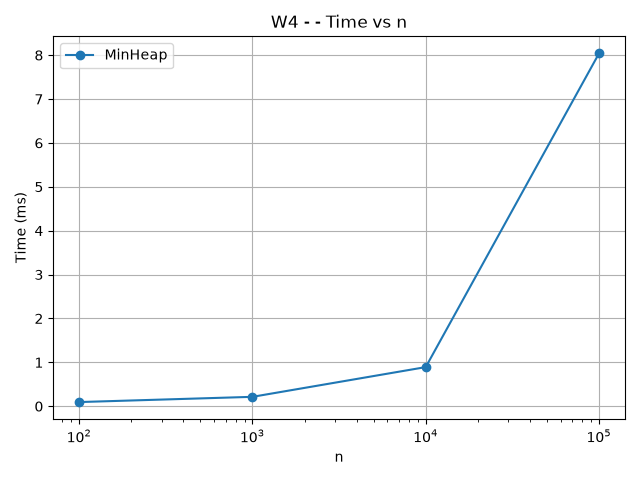
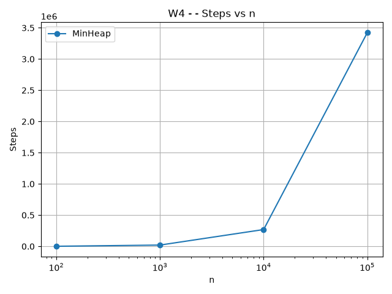

# Assignment 2 - Data Structures

**Course:** Design and Analysis of Algorithms  
**Student:** Sayazhan Kanat

## 1. Introduction

In this assignment I implemented three data structures from scratch: DynamicArray, MyLinkedList and MinHeap. All structures store primitive int values. I also added operation counters for steps, moves and comparisons.

The purpose of the benchmark was to compare the structures for random access, search, insertion and removal, and priority processing. The benchmark uses the same random seed (42), one warm-up run and five measured runs. The median time is saved in results.csv.

---

## 2. Complexity Analysis

### DynamicArray

| Operation | Best | Average | Worst | Auxiliary Space | Explanation |
|---|---|---|---|---|---|
| add(x) | Θ(1) | Θ(1) amortized | Θ(n) | Θ(n) during grow | Usually adds at the end, but resizing copies all elements. |
| add(index, x) | Θ(1) | Θ(n) | Θ(n) | Θ(n) during grow | Elements after the index may need to be shifted. |
| remove(index) | Θ(1) | Θ(n) | Θ(n) | Θ(1) | Elements after the removed element are shifted left. |
| get(index) | Θ(1) | Θ(1) | Θ(1) | Θ(1) | Direct array access by index. |
| contains(x) | Θ(1) | Θ(n) | Θ(n) | Θ(1) | Linear search through the array. |

### MyLinkedList

| Operation | Best | Average | Worst | Auxiliary Space | Explanation |
|---|---|---|---|---|---|
| add(x) | Θ(1) | Θ(n) | Θ(n) | Θ(1) | The implementation traverses the list to find the last node. |
| add(index, x) | Θ(1) | Θ(n) | Θ(n) | Θ(1) | Head insertion is constant, but other positions require traversal. |
| remove(index) | Θ(1) | Θ(n) | Θ(n) | Θ(1) | Removing the head is constant, while other positions require traversal. |
| get(index) | Θ(1) | Θ(n) | Θ(n) | Θ(1) | The list must follow next references from the head. |
| contains(x) | Θ(1) | Θ(n) | Θ(n) | Θ(1) | Nodes are checked one by one. |

### MinHeap

| Operation | Best | Average | Worst | Auxiliary Space | Explanation |
|---|---|---|---|---|---|
| insert(x) | Θ(1) | O(log n) | Θ(log n) | Θ(n) during grow | A new value may bubble up through the heap. |
| peekMin() | Θ(1) | Θ(1) | Θ(1) | Θ(1) | The minimum is stored at index 0. |
| extractMin() | Θ(1) | O(log n) | Θ(log n) | Θ(1) | The root is replaced and may bubble down. |

---

## 3. Loop Invariant Proofs

### 3.1 DynamicArray contains()

**Invariant:** Before every iteration with index `i`, none of the elements at indexes `0` to `i - 1` is equal to the searched value.

**Initialization:** Before the first iteration, `i = 0`. No elements have been checked yet, so the invariant is true.

**Maintenance:** During an iteration, `data[i]` is compared with the searched value. If they are equal, the method returns true. Otherwise, `data[i]` is also known not to contain the searched value. Therefore, before the next iteration, all elements before the new value of `i` have been checked and are different from the searched value.

**Termination:** The loop terminates either when the value is found or when `i == size`. If `i == size`, every stored element has been checked and none is equal to the searched value.

**Conclusion:** Therefore, the method returns true exactly when the value exists in the DynamicArray and false otherwise.

### 3.2 MinHeap bubble-down in extractMin()

**Invariant:** Before every iteration, the heap property is correct everywhere except possibly between the node at `current` and its children.

**Initialization:** After the last heap element is moved to index 0, the two subtrees below the root still satisfy the heap property. Only the new root may be larger than one of its children.

**Maintenance:** The algorithm finds the smallest value among `current`, the left child and the right child. If a child is smaller, the algorithm swaps `current` with the smallest child. The previous position becomes correct, and only the new position of `current` may still violate the heap property.

**Termination:** The loop stops when `current` is not larger than either child, or when it has no smaller child.

**Conclusion:** At termination the heap property holds for every parent-child pair, so extractMin leaves a valid MinHeap.

---

## 4. Benchmark Results

The benchmark was executed for:

- n = 100
- n = 1,000
- n = 10,000
- n = 100,000

The data was generated using `new Random(42)`. One warm-up run was discarded and the median of five measured runs was used.

### W1 - Random Access

DynamicArray remained very fast because `get(index)` directly accesses an array cell. MyLinkedList became slower as n increased because it has to follow nodes from the head to the requested index.

### W2 - Search

Both structures perform a linear search. Their comparison counts are the same because they process the same queries and values. However, their running times are different because their memory layouts are different.

### W3 - Insert and Remove at Head

MyLinkedList performs well at the head because it only changes links. DynamicArray has to shift many elements for insertion and removal at index 0.

### W3 - Insert and Remove in Middle

For middle operations, MyLinkedList has to traverse approximately half of the list before changing links. DynamicArray performs many shifts, but sequential array access is efficient in memory.

### W4 - Priority Processing

MinHeap maintained the heap property while inserting and extracting values. Repeated calls to extractMin returned values in non-decreasing order.

---

## 5. Discussion

DynamicArray is much faster for random access because an index directly identifies the required array cell. Its elements are also stored next to each other in memory, which gives good spatial locality and allows the CPU cache to load nearby values efficiently. MyLinkedList stores separate node objects and each node contains a reference to the next node. To access an element, the program must follow these references one by one, which causes pointer chasing. Nodes may be located in different areas of memory, so cache locality is worse than for an array. Node objects also have additional memory overhead for object headers and references, and many objects can create more work for the garbage collector. This helps explain why two structures can perform a similar number of logical operations but still have different real execution times.

For insertion and removal at the head, MyLinkedList is a better choice because only a small number of links need to change. DynamicArray is expensive for these operations because many elements must be shifted. For middle operations, the linked list must first traverse to the required position, which can make it slower despite having fewer element moves. DynamicArray is therefore a good choice when fast indexed access and cache-friendly iteration are important. MyLinkedList is useful when operations are performed near a known boundary or node and shifting array elements would be expensive. MinHeap is the better choice for priority processing because the minimum value can be read in constant time and insertion and extraction require at most logarithmic restructuring.

---

## 6. Conclusion

The experiments showed that Big-O complexity is important, but it does not explain every performance difference. Memory layout, cache locality, pointer traversal and the number of physical moves also affect real execution time. DynamicArray performed best for random access, MyLinkedList was especially effective for operations at the head, and MinHeap provided efficient priority-based processing.